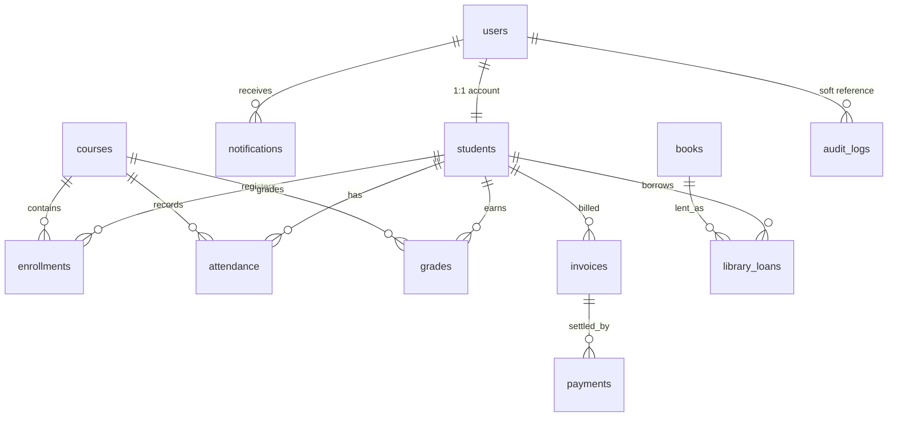
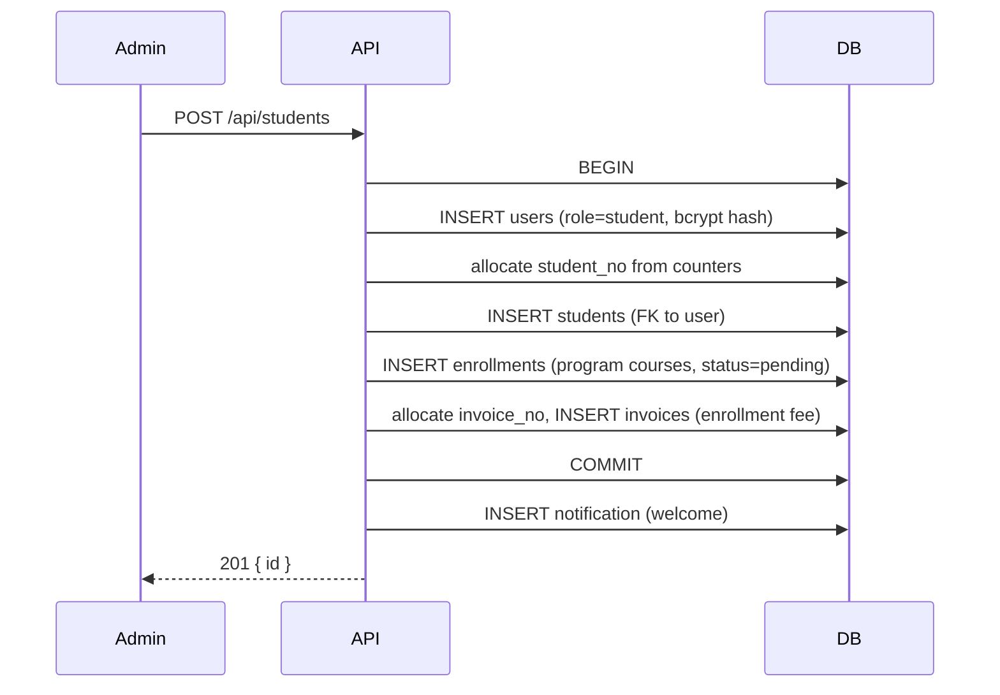

# Architecture

How SIS is put together, why it is structured this way, and how data moves between modules.

- [1. Runtime topology](#1-runtime-topology)
- [2. Backend](#2-backend)
- [3. Data model](#3-data-model)
- [4. Frontend](#4-frontend)
- [5. Integration workflows](#5-integration-workflows)
- [6. Cross-cutting concerns](#6-cross-cutting-concerns)
- [7. Design decisions and trade-offs](#7-design-decisions-and-trade-offs)

---

## 1. Runtime topology

```
┌────────────────────────────┐        ┌──────────────────────────────┐
│ Browser (React SPA)        │        │ Express API (:4000)          │
│                            │        │                              │
│  AuthContext  ── token ────┼───────▶│  auth middleware (JWT)       │
│  api.js  /api/* ───────────┼───────▶│  routers per module          │
│  role guards + nav         │        │  audit middleware            │
└────────────────────────────┘        └───────────────┬──────────────┘
                                                      │ mysql2 pool
                                      ┌───────────────▼──────────────┐
                                      │ MySQL 8.4                    │
                                      │ embedded (default) or external│
                                      └──────────────────────────────┘
```

Development has two processes: Vite on `:5173` proxying `/api` to Express on `:4000`.
Production has one: Express serves `client/dist` as static files and falls back to
`index.html` for client-side routes, so the SPA and API share an origin.

### Startup sequence (`server/src/index.js`)

1. Load configuration from environment (`config.js`, `dotenv`).
2. `initDb()`:
   - `DB_MODE=embedded` → `mysql-memory-server` downloads (once) and starts MySQL on a random port with a temporary data directory.
   - `DB_MODE=external` → connect to the configured server and create the database if missing.
   - Create the `mysql2` pool (`dateStrings: true`, `decimalNumbers: true`, `multipleStatements: true`).
   - If `DB_AUTO_INIT` is not `false`: run `sql/schema.sql`, then `seedDatabase()`.
3. Listen on `PORT`; SIGINT/SIGTERM close the server and the pool.

---

## 2. Backend

### Layout

| Path | Responsibility |
| --- | --- |
| `src/app.js` | Express app: CORS, JSON body limit (1 MB), audit middleware, routers, API 404, static SPA, error handler |
| `src/config.js` | Environment-backed configuration object |
| `src/db.js` | Pool creation, embedded/external selection, schema + seed bootstrap, `query()` helper |
| `src/middleware/auth.js` | `auth` (verify JWT), `adminOnly`, `allowRoles(...)` |
| `src/middleware/audit.js` | Writes an `audit_logs` row for every non-GET `/api` request |
| `src/routes/*.js` | One router per module, each mounted under `/api/<module>` |
| `src/utils/` | `HttpError` + `asyncHandler`, date helpers, notification fan-out, atomic numbering |

### Request lifecycle

```
request
  → express.json            (body parsed, malformed JSON → 400)
  → auditTrail              (registers res 'finish' listener)
  → router-level auth       (JWT → req.user = { id, role, name, email })
  → router-level role guard (adminOnly / allowRoles / per-route checks)
  → handler                 (query() or a transaction on a dedicated connection)
  → JSON response
  → 'finish' listener       (INSERT INTO audit_logs, failures ignored)
  → error handler           (HttpError → status + message; anything else → 500 "Something went wrong")
```

`asyncHandler` wraps every async handler so thrown `HttpError`s reach the central
error middleware instead of becoming unhandled rejections.

### Transactions

Anything that must be atomic uses a single connection:

- Creating a student (user + student + enrollments + invoice)
- Deleting an enrollment or removing a student from a course (cascade of attendance/grades)
- Saving an attendance sheet (row upserts)
- Recording a loan or a return (loan row + `books.copies_available`)
- Creating an invoice (counter allocation + insert)

### Numbering

Student numbers (`2026-0009`) and invoice numbers (`INV-2026-0017`) are allocated from
the `counters` table:

```sql
INSERT INTO counters (name, value) VALUES (?, ?) ON DUPLICATE KEY UPDATE value = value;
UPDATE counters SET value = LAST_INSERT_ID(value + 1) WHERE name = ?;
SELECT LAST_INSERT_ID();
```

The increment is atomic in InnoDB, so concurrent requests cannot receive the same
number. Both statements must run on the same connection (`LAST_INSERT_ID()` is
connection-scoped). The first allocation seeds the counter from the highest existing
number so imported data does not collide.

---

## 3. Data model

Thirteen InnoDB tables with `utf8mb4`: twelve domain tables plus `counters`.



### Tables

| Table | Key columns | Notes |
| --- | --- | --- |
| `users` | `id` PK, `email` UQ, `password_hash`, `role` (`admin`/`librarian`/`student`), `is_active` | One login per person; students always have a matching `students` row |
| `students` | `id` PK, `user_id` UQ FK→users, `student_no` UQ, `program`, `year_level`, `section`, `status` (`active`/`inactive`/`graduated`) | Deleting the user cascades to this record |
| `courses` | `id` PK, `code` UQ, `title`, `program`, `units`, `schedule`, `room`, `semester` | Catalog shared by all programs |
| `enrollments` | `id` PK, `student_id` FK, `course_id` FK, `status` (`pending`/`enrolled`/`completed`/`dropped`), `UNIQUE(student_id, course_id)` | The join table the registrar owns |
| `attendance` | `id` PK, `student_id`, `course_id`, `attendance_date`, `status` (`present`/`absent`/`late`/`excused`), `remarks`, `UNIQUE(student_id, course_id, attendance_date)` | Upserted per roll call |
| `grades` | `id` PK, `student_id`, `course_id`, `term`, `assignment`, `score`, `max_score` | Percentages derived in queries (`score / max_score`) |
| `invoices` | `id` PK, `invoice_no` UQ, `student_id`, `amount`, `due_date`, `status` (`unpaid`/`partial`/`paid`/`overdue`) | `overdue` is refreshed on read |
| `payments` | `id` PK, `invoice_id` FK, `amount`, `method` (`cash`/`card`/`bank_transfer`/`online`), `reference` | Balance is always recomputed from the payment sum |
| `notifications` | `id` PK, `user_id` FK, `title`, `message`, `type`, `channel`, `is_read` | `channel` is a comma string such as `in_app,email` |
| `books` | `id` PK, `isbn` UQ, `title`, `author`, `category`, `copies_total`, `copies_available` | Availability is maintained transactionally |
| `library_loans` | `id` PK, `student_id`, `book_id`, `date_borrowed`, `due_date`, `returned_at`, `status` | `overdue` is derived at query time |
| `audit_logs` | `id` PK, `user_id` (no FK), `actor`, `role`, `method`, `path`, `status`, `ip` | Deliberately keeps history after a user is deleted |
| `counters` | `name` PK, `value` | Atomic number allocation (see above) |

### Derived values

Nothing is denormalised; aggregates are computed in SQL:

- Attendance rate = `present + late` ÷ all records (per student, per course, campus-wide)
- Average grade = mean of `score / max_score * 100`
- Outstanding balance = `SUM(invoice.amount) - SUM(payments.amount)` per invoice/student
- Overdue loans = `status = 'borrowed' AND due_date < CURDATE()`
- `overdue` invoices are flipped by `refreshOverdue()` before invoice reads

---

## 4. Frontend

### Structure

| Area | Files | Notes |
| --- | --- | --- |
| Providers | `main.jsx` | `BrowserRouter` → `ThemeProvider` → `AuthProvider` → `ToastProvider` → `App` |
| Routing | `App.jsx` | Route table + `RequireRole` / `AdminOnly` guards |
| Shell | `components/Layout.jsx` | Sidebar per role, unread badge polled every 60 s, topbar |
| UI kit | `components/ui.jsx` | `Avatar`, `Badge`, `StatusBadge`, `PageHeader`, `StatCard`, `Progress`, `EmptyState`, `Loading`, `Modal` |
| Data | `lib/api.js` | `fetch` wrapper, token storage, 401 broadcast, formatters |
| State | `context/AuthContext.jsx`, `context/ToastContext.jsx`, `context/ThemeContext.jsx` | Session restore, login/logout, transient toasts, light/dark theme |
| Screens | `pages/*.jsx` | One page per route; admin/librarian/student variants where needed |

### Routes

| Path | Component | Allowed roles |
| --- | --- | --- |
| `/login` | `Login` | anonymous |
| `/` | `Dashboard` (librarian → `/library`) | all |
| `/students`, `/students/:id` | `Students`, `StudentDetail` | admin |
| `/enrollment` | `Enrollment` | admin |
| `/courses` | `Courses` | admin, student |
| `/attendance` | `Attendance` | admin, student |
| `/library` | `Library` | all |
| `/billing` | `Billing` | admin, student |
| `/notifications` | `Notifications` | all |
| `/reports` | `Reports` | admin |
| `/profile` | `Profile` | admin, student |
| `/settings` | `Settings` | all |
| `/integration`, `/about` | `Integration`, `About` | all |

Guards render `<Navigate to="/" replace />` for disallowed roles; `Home` then sends
librarians to their workspace, so a librarian opening `/billing` lands on `/library`.

### Session handling

`AuthContext` restores a session by calling `GET /auth/me` when a token exists in
`localStorage`. Any 401 from `lib/api.js` clears the token and dispatches
`sis:unauthorized`, which drops the user and lets the router redirect to `/login`. An account
deactivated by an administrator receives `401` from `/auth/me`, so the next page load signs out.

### Styling

`styles.css` holds design tokens (`:root`) plus component styles. Pages use semantic
class names (`.stat-card`, `.table`, `.nav-item`) rather than utility classes. The
current theme is blue/light-blue: light surface hierarchy, a light blue gradient
sidebar with white active pills, saturated blue hero panels, and blue data-viz
accents. Editing the tokens re-themes the entire app.

The dark theme is a second token block (`[data-theme='dark']`) that overrides the same
variables with a deep navy palette. `ThemeContext` stores the choice under `sis-theme` and
applies it to `<html>`; a short script in `index.html` reads the saved value before first
paint, so reloading never flashes the wrong theme. **Settings** exposes the Light and Dark
options. Component rules that could not use tokens (the sidebar gradient, topbar overlay,
badge tints, chart grid) have explicit dark overrides.

---

## 5. Integration workflows

### 5.1 Student onboarding (registrar)



### 5.2 Settlement activates classes (bursar → registrar)

`POST /billing/invoices/:id/pay` validates the amount against the outstanding balance,
inserts a payment, recalculates the invoice status, and then checks whether the student
still has any invoice that is not `paid`. If none remain, every `pending` enrollment for
that student becomes `enrolled`, and the notification reports the count.

### 5.3 Roll call (attendance → notifications)

A sheet save upserts one row per submitted student. For students whose status becomes
`absent` or `late` (and was different before), a notification is queued and written
after the transaction commits, so a notification failure cannot roll back attendance.

### 5.4 Library lifecycle

Loan creation checks availability, inserts the loan and decrements `copies_available`
in one transaction. Return flips `status`/`returned_at` and increments availability.
Overdue is never stored: it is derived from `due_date < CURDATE()` so it cannot go stale.

### 5.5 Announcements

`POST /notifications/announce` resolves recipients by role (`students`, `admins`, `all`),
bulk-inserts one notification per active user, and logs simulated email/SMS delivery for
the selected channels.

---

## 6. Cross-cutting concerns

| Concern | Implementation |
| --- | --- |
| Authentication | `Authorization: Bearer <jwt>`; HS256; payload `{ id, role, name, email, iat, exp }`; 7-day expiry |
| Authorisation | `adminOnly`, `allowRoles`, and per-route ownership checks (`student.user_id === req.user.id`) |
| Validation | Shared `required()`, `parseId()` and `parseISODate()` helpers, enum whitelists, range checks (grades, course units), per-module rules. Invalid input returns `400` instead of reaching MySQL |
| Error shape | Always `{ "error": "message" }`; `HttpError` statuses (400/401/403/404/409) or a generic 500 |
| Audit | Non-GET `/api` requests are logged after the response with actor, role, path, status, IP |
| Notifications | `notifyUsers()` bulk insert; `simulateDelivery()` logs email/SMS |
| Money | `DECIMAL` columns returned as numbers (`decimalNumbers: true`), formatted client-side as PHP |
| Dates | `dateStrings: true` → `YYYY-MM-DD` / `YYYY-MM-DD HH:mm:ss`; the client normalises the space before parsing |

---

## 7. Design decisions and trade-offs

**Embedded MySQL instead of SQLite.** This is a relational-database system: real
foreign keys, `ENUM`s and InnoDB transactions matter. `mysql-memory-server` removes the
install step at the cost of a first-run download and an ephemeral database.

**Services share one schema.** A microservice split would be more "integration"-like but
would not exercise the constraints, transactions and joins the schema depends on.
The module boundaries live in the routers instead.

**Derived aggregates over stored counters.** Attendance rates and balances are computed on
read, so they cannot drift. The trade-off is more work per query, which is fine at this scale.

**Role checks in two layers.** The SPA hides what a role cannot use, and the API enforces
it independently, so a hand-crafted request cannot reach another role's data.

**No external state.** No Redis, no queues, no mail provider: notifications are rows,
deliveries are logs, and everything runs on one machine.

**Testing.** `npm test` runs Node's built-in test runner. The API suite boots the Express app
on an ephemeral port with its own embedded MySQL database, so it is independent of the
development server and of external data. Helper tests cover the shared validators, date
utilities and client formatters.

**Known gaps.** No rate limiting, no token refresh, and no payment gateway. The database
resets on restart by design (see the README's limitations section).
